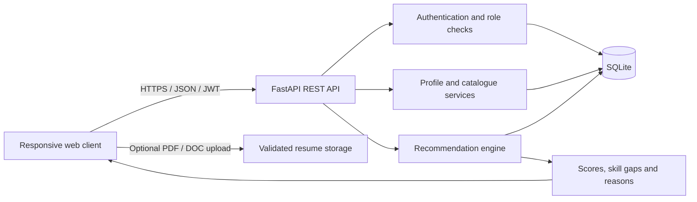
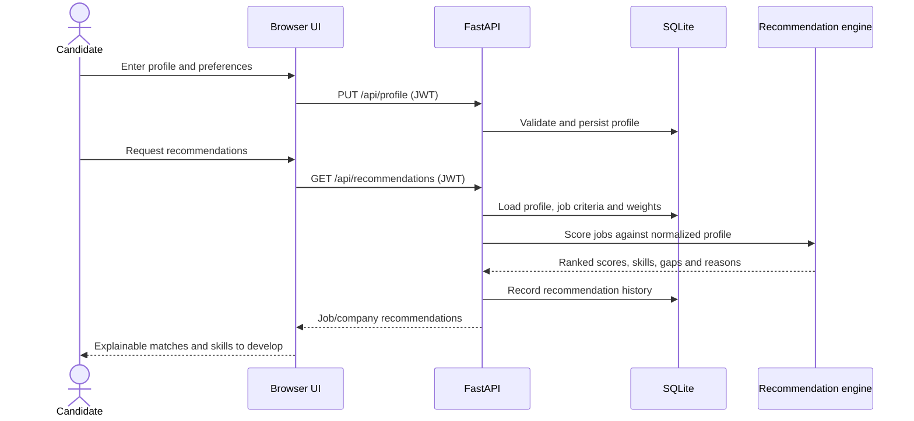

# SkillMatch

SkillMatch is a full-stack, explainable job and company recommendation demo. Users create a career profile, explore jobs, see evidence behind each match, discover missing skills, and save roles or companies. Admins manage the company/job catalogue and adjust the recommendation weights.

## Features

- Responsive dashboard, job and company discovery from the profile and company directory, profile editor, saved items, recommendations, and admin panel.
- Apply to active job listings and retain application status across recommendations and saved roles.
- Registration/login with scrypt password hashing, 24-hour signed JWTs, and role-based administrator authorization.
- SQLite relational schema with foreign keys, uniqueness/check constraints, and indexes.
- Configurable, normalized weighted recommendation scoring with skill aliases, matching/missing skills, match factors, and plain-language explanations.
- Search by keyword, skills, role, industry, location, work mode, experience and salary, and minimum match percentage.
- Optional resume upload limited to 5 MB and PDF/DOC/DOCX file types.
- Sample jobs across five industries; interactive OpenAPI docs at `/docs`.

## Run locally

Requires Python 3.10 or later and pip.

Start the backend in one PowerShell terminal:

```powershell
$env:SECRET_KEY = "replace-with-a-long-random-secret"
$env:ADMIN_EMAIL = "admin@example.com"
$env:ADMIN_PASSWORD = "change-this-before-deployment"
python -m uvicorn main:app --reload
```

Start the separate frontend in a second terminal:

```powershell
python frontend_server.py
```

Open the frontend at [http://127.0.0.1:5500](http://127.0.0.1:5500). The backend API and interactive Swagger docs are at [http://127.0.0.1:8000/docs](http://127.0.0.1:8000/docs); OpenAPI JSON is at `/openapi.json`. The frontend is configured to call the backend on port 8000, and the API allows the frontend origin by default. Set `FRONTEND_ORIGIN` to a comma-separated list of allowed origins if you use different frontend URLs. The database is created as `skillmatch.db` on first run. Copy `.env.example` for reference; environment variables are read from the process, and no dotenv loader is required.

For a production deployment, set a unique long random `SECRET_KEY`, secure the database and upload directory, configure HTTPS and trusted origins at the hosting layer, and set a strong administrator password. The built-in development secret is not suitable for deployment.

## Tests

```powershell
python -m pytest -q
```

Tests cover scoring, normalized skill aliases, registration and login, duplicate accounts, profile updates, recommendations, saving roles, filtering, dashboard data, and admin authorization.

## Recommendation approach

`recommender.py` is independent of the web layer so the scoring implementation can be replaced by TF-IDF, an embedding model, or a learned ranker later. Current match factors are:

| Factor | Default weight |
|---|---:|
| Required skill coverage | 50% |
| Experience | 15% |
| Education | 10% |
| Preferred role | 10% |
| Industry | 5% |
| Location | 5% |
| Certifications / projects | 5% |

The total is normalized by the sum of configured weights, so admins can alter the relative importance from the dashboard. The skill factor blends required-skill coverage (85%) with TF-IDF/cosine similarity between the user's skills/projects/certifications and the role description (15%). Required skills use a normalized skill dictionary (for example, JS → JavaScript and ML → Machine Learning). Matching skills, missing skills, text similarity, factor scores, and natural-language reasons are returned with each job. Experience is fully matched at or above the minimum, scales up below it, and is gently reduced above the maximum. Unspecified preferences are treated as non-matches rather than artificially increasing a score.

The text similarity implementation is a small, transparent TF-IDF/cosine implementation suitable for this project demo. It is not a trained ranking model; description similarity and personalization from feedback can be improved later with a larger corpus or embeddings.

## API overview

All endpoints use JSON unless otherwise noted. Authenticated endpoints require `Authorization: Bearer <token>`.

| Method | Path | Access | Purpose |
|---|---|---|---|
| POST | `/api/auth/register` | Public | Create account |
| POST | `/api/auth/login` | Public | Issue JWT |
| GET | `/api/auth/me` | User | Current account |
| GET / PUT | `/api/profile` | User | Read/update profile |
| POST | `/api/profile/resume` | User | Upload resume (`multipart/form-data`, field `file`) |
| GET | `/api/dashboard` | User | Overview, skills demand and skill gaps |
| GET | `/api/jobs` | User | Search/filter ranked jobs |
| POST | `/api/jobs/{job_id}/apply` | User | Apply to an active job |
| GET | `/api/companies` | User | Search/filter companies |
| GET | `/api/recommendations` | User | Explainable job and company matches |
| GET | `/api/saved` | User | List saved items |
| POST | `/api/saved/{job\|company}/{id}` | User | Toggle a saved item |
| GET | `/api/admin/overview` | Admin | Counts and management lists |
| POST / PUT / DELETE | `/api/admin/companies[/{id}]` | Admin | Manage companies |
| POST / PUT / DELETE | `/api/admin/jobs[/{id}]` | Admin | Manage jobs and skills |
| GET / PUT | `/api/admin/weights` | Admin | Read/update scoring weights |

Job query parameters: `search`, `skill`, `role`, `industry`, `location`, `company_size`, `work_mode` (`Remote`, `Hybrid`, `On-site`), `min_experience`, `max_salary`, and `min_match` (0–100). Company parameters: `search`, `industry`, `location`, and `size`. Request and response shapes, validation, and error responses are documented in Swagger/OpenAPI.

## Database and architecture

The FastAPI service serves the static responsive client and JSON API. SQLite persists normalized profile/catalogue data. A replaceable scoring module ranks job rows and returns explanation data; dashboard/search UI renders it without duplicating scoring rules.



### ER diagram

```mermaid
erDiagram
  USERS ||--|| USER_PROFILES : has
  USERS ||--o{ USER_SKILLS : lists
  USERS ||--o{ USER_EDUCATION : records
  USERS ||--o{ USER_CERTIFICATIONS : earns
  USERS ||--o{ USER_PROJECTS : builds
  COMPANIES ||--o{ JOBS : offers
  JOBS ||--o{ JOB_SKILLS : requires
  USERS ||--o{ SAVED_ITEMS : saves
  USERS ||--o{ RECOMMENDATION_HISTORY : receives
  JOBS ||--o{ RECOMMENDATION_HISTORY : ranked
  USERS { int id PK; string email UK; string password_hash; string role }
  USER_PROFILES { int user_id PK_FK; float experience_years; string education; json preferred_roles }
  USER_SKILLS { int user_id PK_FK; string skill PK; string level }
  USER_EDUCATION { int id PK; int user_id FK; string qualification; string field_of_study; string institution }
  USER_CERTIFICATIONS { int id PK; int user_id FK; string name }
  USER_PROJECTS { int id PK; int user_id FK; string name; string description }
  COMPANIES { int id PK; string name UK; string industry; string location; string size }
  JOBS { int id PK; int company_id FK; string title; float experience_min; float experience_max }
  JOB_SKILLS { int job_id PK_FK; string skill PK; bool required }
  SAVED_ITEMS { int user_id PK_FK; string item_type PK; int item_id PK }
  RECOMMENDATION_HISTORY { int id PK; int user_id FK; int job_id FK; float score }
```

### Data flow



## Project structure

```text
main.py                 FastAPI routes, auth, persistence and service wiring
recommender.py          Isolated explainable matching/scoring module
schema.sql              Relational schema, constraints and indexes
data/sample_companies.json  Human-readable sample dataset
static/                 Responsive browser client
tests/test_app.py       Recommendation and API tests
.env.example            Environment variable reference
```

## Security and scope

Passwords are hashed with scrypt, tokens expire after 24 hours, route dependencies enforce user/admin roles, request payloads are validated, SQL parameters are bound, and resume names are server-generated. Resume size/type is restricted. This is a demonstration project, not a security-certified hiring product: production use needs HTTPS, rate limiting, account recovery, malware scanning, retention controls, audit logging, accessibility review, and a robust secure-session/key-management plan. Skill or education matching should support, not automate, hiring decisions.

## Future scope

- Add TF-IDF/cosine similarity or sentence embeddings for job descriptions and user project text.
- Learn ranking weights from explicit feedback, with fairness audits and opt-in data handling.
- Add email verification, password reset, refresh/revocation strategy, rate limits, and audit history.
- Move from SQLite to PostgreSQL for concurrent production workloads and add migration tooling.
- Add resume parsing with user consent and malware scanning; never treat extracted data as trusted.
- Add company/job pagination, richer salary/currency fields, and scheduled catalogue imports.
- Expand automated browser/component and load tests, plus accessible keyboard/screen-reader verification.
# skill-based-company-recommandation-system

