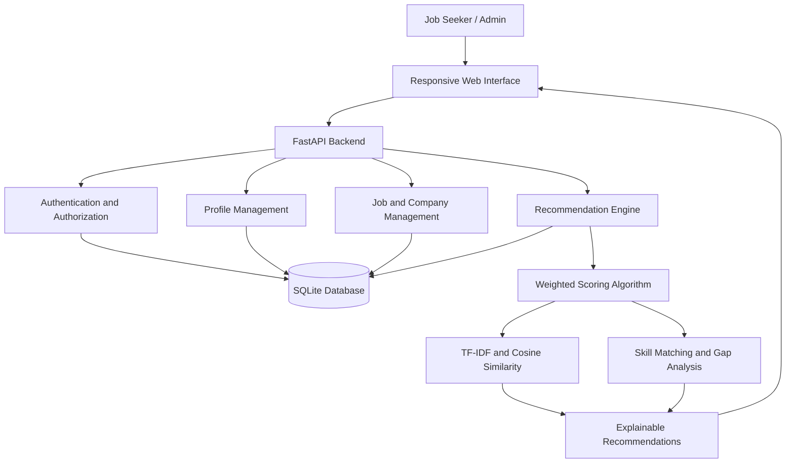
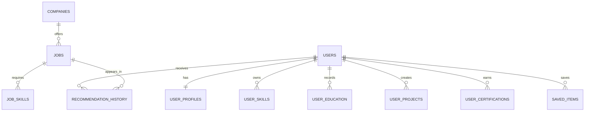

# 🎯 SkillMatch – Skill-Based Company Recommendation System

**An Explainable AI-Powered Job and Company Recommendation Platform**

SkillMatch is a full-stack web application that helps job seekers discover suitable jobs and companies based on their skills, qualifications, experience, interests, and career preferences.

The system uses an explainable weighted recommendation algorithm to calculate job compatibility scores, identify matching and missing skills, and provide understandable explanations for every recommendation.

It also provides an administrative dashboard to manage companies, job listings, and recommendation scoring weights.

---

## 🚀 Key Features

### 👨‍💻 Job Seeker Features
- User registration and secure login.
- Personalized career profile creation and editing.
- Skill-based job recommendations.
- Company discovery and recommendations.
- Explainable job matching with compatibility percentages.
- Identification of matching and missing skills.
- Search and filter jobs by keyword, skills, role, industry, location, experience, salary, and work mode.
- Save favorite jobs and companies.
- Apply to active job listings.
- Track application status.
- Optional resume upload (PDF, DOC, DOCX; maximum 5 MB).
- Interactive dashboard with career insights and skill gaps.

### 🛡️ Admin Features
- Role-based administrator authentication.
- Manage company information.
- Add, update, and delete job listings.
- Manage required and optional job skills.
- Configure recommendation algorithm weights.
- View dashboard statistics and management information.

### 🧠 Explainable Recommendation Engine
- Weighted recommendation scoring.
- Skill normalization and alias matching.
- Required skill coverage calculation.
- TF-IDF and cosine similarity.
- Experience and education matching.
- Preferred role and industry matching.
- Location and certification matching.
- Matching skills and missing skills identification.
- Natural-language explanations for recommendations.

---

## 🛠️ Technology Stack

| Category | Technologies |
|---|---|
| Backend | Python, FastAPI |
| Frontend | HTML, CSS, JavaScript |
| Database | SQLite |
| Authentication | JWT, scrypt |
| Recommendation Engine | Weighted Scoring, TF-IDF |
| Similarity Measurement | Cosine Similarity |
| API Documentation | Swagger / OpenAPI |
| Testing | Pytest |
| Version Control | Git, GitHub |

---

## 🏗️ System Architecture



---

## 🧠 Recommendation Algorithm

SkillMatch uses a configurable weighted scoring algorithm to evaluate how closely a candidate matches a job opportunity.

### Default Recommendation Weights

| Matching Factor | Weight |
|---|---:|
| Required Skill Coverage | 50% |
| Experience | 15% |
| Education | 10% |
| Preferred Role | 10% |
| Industry | 5% |
| Location | 5% |
| Certifications / Projects | 5% |
| **Total** | **100%** |

### Recommendation Formula

The recommendation score is calculated using normalized weighted scoring:

\[
Score = \frac{\sum_{i=1}^{n} w_i s_i}{\sum_{i=1}^{n} w_i}\times100
\]

Where:

- \(w_i\) = Weight assigned to a matching factor.
- \(s_i\) = Matching score of that factor.
- \(n\) = Total number of recommendation factors.

### Skill Matching

The skill matching component combines:

- 85% Required skill coverage.
- 15% TF-IDF and cosine similarity between candidate skills, projects, certifications, and job descriptions.

The system also supports skill aliases, such as:

- JS → JavaScript
- ML → Machine Learning

### Explainability

For every recommendation, the system provides:

- Overall match percentage.
- Matching skills.
- Missing skills.
- Individual factor scores.
- Text similarity score.
- Natural-language recommendation explanations.

**Note:** The current TF-IDF implementation is a lightweight, transparent similarity approach, not a trained ranking model.

---

## ⚙️ Installation and Setup

### Prerequisites

Install the following:

- Python 3.10 or later.
- pip.
- Git.
- VS Code (recommended).

### 1. Clone the Repository

```bash
git clone https://github.com/jayptl0811-lab/skill-based-company-recommandation-system.git
```

### 2. Navigate to the Project Directory

```bash
cd skill-based-company-recommandation-system
```

### 3. Create a Virtual Environment

```powershell
python -m venv .venv
```

### 4. Activate the Virtual Environment

Windows PowerShell:

```powershell
.\.venv\Scripts\Activate.ps1
```

### 5. Install Dependencies

```bash
pip install -r requirements.txt
```

### 6. Configure Environment Variables

Set your environment variables in PowerShell:

```powershell
$env:SECRET_KEY = "replace-with-a-long-random-secret"
$env:ADMIN_EMAIL = "admin@example.com"
$env:ADMIN_PASSWORD = "change-this-before-deployment"
```

Never use the example credentials or a development secret in production.

### 7. Start the Backend Server

```bash
python -m uvicorn main:app --reload
```

Backend API:

http://127.0.0.1:8000

### 8. Start the Frontend Server

Open a second PowerShell terminal in the project directory and activate the virtual environment if needed.

```bash
python frontend_server.py
```

Frontend application:

http://127.0.0.1:5500

### 9. Access Swagger API Documentation

http://127.0.0.1:8000/docs

OpenAPI JSON:

http://127.0.0.1:8000/openapi.json

---

## 📡 API Endpoints

All API endpoints use JSON unless otherwise specified.

| Method | Endpoint | Access | Description |
|---|---|---|---|
| POST | `/api/auth/register` | Public | Register a new user |
| POST | `/api/auth/login` | Public | User login and JWT generation |
| GET | `/api/auth/me` | User | Get current user |
| GET / PUT | `/api/profile` | User | View and update profile |
| POST | `/api/profile/resume` | User | Upload resume |
| GET | `/api/dashboard` | User | Dashboard information |
| GET | `/api/jobs` | User | Search and filter jobs |
| POST | `/api/jobs/{job_id}/apply` | User | Apply for a job |
| GET | `/api/companies` | User | Explore companies |
| GET | `/api/recommendations` | User | Get personalized recommendations |
| GET | `/api/saved` | User | View saved items |
| POST | `/api/saved/{job\|company}/{id}` | User | Save or unsave an item |
| GET | `/api/admin/overview` | Admin | Admin dashboard |
| POST / PUT / DELETE | `/api/admin/companies` | Admin | Manage companies |
| POST / PUT / DELETE | `/api/admin/jobs` | Admin | Manage jobs |
| GET / PUT | `/api/admin/weights` | Admin | Manage recommendation weights |

Authenticated endpoints require:

```http
Authorization: Bearer <JWT_TOKEN>
```

For complete request and response details, visit the Swagger documentation.

---

## 🗄️ Database Design

The application uses SQLite as its relational database.

### Main Database Entities

- **Users:** Stores user account information and authentication details.
- **User Profiles:** Stores career preferences and experience.
- **User Skills:** Stores candidate skills and proficiency levels.
- **User Education:** Stores academic qualifications.
- **User Certifications:** Stores certifications.
- **User Projects:** Stores candidate project information.
- **Companies:** Stores company details.
- **Jobs:** Stores available job opportunities.
- **Job Skills:** Stores required and optional job skills.
- **Saved Items:** Stores favorite jobs and companies.
- **Recommendation History:** Stores recommendation records and scores.

### Entity Relationship Diagram



---

## 🧪 Testing

The project includes automated tests using Pytest.

Run the test suite:

```bash
python -m pytest -q
```

The tests cover:

- Recommendation scoring.
- Skill normalization and aliases.
- User registration and authentication.
- Duplicate account prevention.
- Profile updates.
- Job recommendations.
- Saving jobs and companies.
- Job filtering.
- Dashboard information.
- Administrator authorization.

---

## 🔐 Security Considerations

The application implements several security measures:

- Password hashing using scrypt.
- JWT-based authentication with 24-hour expiration.
- Role-based access control.
- Request validation.
- Parameterized SQL queries.
- Foreign key constraints.
- Restricted resume file types and upload size.
- Server-generated resume filenames.

**Security Notice:** SkillMatch is an academic/demo project, not a security-certified production hiring platform. Production deployment requires additional security reviews, HTTPS, rate limiting, secure secret management, malware scanning, audit logging, and appropriate data-retention controls.

---

## 🔮 Future Enhancements

- Integrate advanced sentence embeddings for semantic job matching.
- Develop machine-learning-based recommendation ranking.
- Introduce feedback-based personalized recommendations.
- Add resume parsing and automatic skill extraction.
- Integrate email notifications and application updates.
- Migrate SQLite to PostgreSQL for production workloads.
- Add company analytics and advanced candidate insights.
- Implement fairness evaluation and bias monitoring.
- Improve recommendation accuracy using larger job datasets.

---

## 🎯 Project Objective

The main objective of SkillMatch is to simplify the job discovery process by connecting candidates with suitable career opportunities based on their actual skills and qualifications.

Unlike traditional job recommendation systems, SkillMatch emphasizes **explainability, transparency, and skill-gap identification**, helping candidates understand not only which jobs match their profiles but also what they need to improve to become better candidates.

---

## 👩‍💻 Author

**Jay Patel**

GitHub: [@jayptl0811-lab](https://github.com/jayptl0811-lab)

Project Repository: [SkillMatch – Skill-Based Company Recommendation System](https://github.com/jayptl0811-lab/skill-based-company-recommandation-system)

---

⭐ If you find this project useful, consider giving it a star!

**Built with Python, FastAPI, and Explainable AI.**